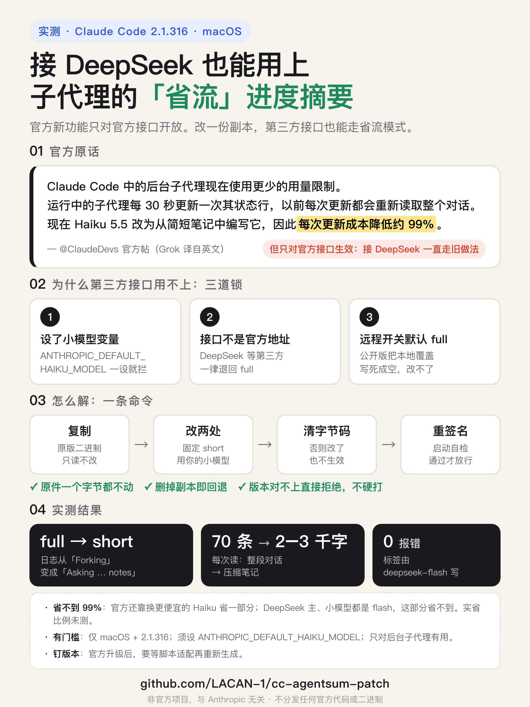

# cc-agentsum-patch

> **非官方项目，与 Anthropic 无关。** 本仓库不包含 Claude Code 的任何代码或二进制。
> 脚本读取你本机已安装的 Claude Code，在本工具自己的目录里生成一份打过补丁的**副本**，原件一个字节都不动。

*English: an unofficial patcher that lets Claude Code sessions on third-party Anthropic-compatible
providers (DeepSeek etc.) use the cheap "short" background-agent progress summaries. macOS only for now.*



## 解决什么问题

Claude Code 会给后台子代理写一行进度标签（比如「Reading runAgent.ts」）。旧做法（`full`）是每写一次标签，
就把子代理的**整段对话**分叉出去重读一遍；新做法（`short`）只读一小段压缩笔记，再交给小模型写。

但新做法只对官方接口开放。只要你接的是第三方接口（`ANTHROPIC_BASE_URL` 不是官方地址），
或者设了 `ANTHROPIC_DEFAULT_HAIKU_MODEL`，Claude Code 就会一直用 `full`。这个补丁让第三方接口也走 `short`，
写标签的模型用你在 `ANTHROPIC_DEFAULT_HAIKU_MODEL` 里指定的那个。

**只有这几类人用得上**：接第三方接口、在交互模式下用、会派后台子代理。直接用官方接口的人不需要它。

**省多少**：比 `full` 少读很多（实测一次从 70 条消息降到约 2–3 千字符的笔记）。但官方说的「省 99%」
有一部分来自换成更便宜的 Haiku——如果你的小模型和主模型是同一个，这部分省不到。实际比例没有测量过。

## 支持范围

| Claude Code 版本 | macOS arm64 | macOS x64 | Linux | Windows |
|---|---|---|---|---|
| 2.1.316 | ✅ 实测通过 | 未测 | 不支持 | 不支持 |
| 其他版本 | 脚本会拒绝 | | | |

Claude Code 几天就发一个版本，相关代码的写法经常变（2.1.314 和 2.1.316 就完全不同）。
**版本不在上表里时脚本直接拒绝**；加 `--allow-untested` 可以试，但只要代码对不上它照样拒绝，不会硬打。

只支持**原生安装**（`~/.local/bin/claude` 指向 `~/.local/share/claude/versions/<版本>`）。npm 安装没测过。

## 用法

需要：macOS、系统自带的 `python3`（3.9 起）、`codesign`（装了 Xcode 命令行工具就有）。

```bash
git clone https://github.com/LACAN-1/cc-agentsum-patch.git && cd cc-agentsum-patch
python3 patch.py                 # 生成 ~/.local/share/cc-agentsum-patch/claude-<版本>-agentsum
```

然后让你接第三方接口的那个会话改用这份副本启动，并设好写标签的模型：

```bash
export ANTHROPIC_BASE_URL=...            # 你原来的第三方配置照旧
export ANTHROPIC_AUTH_TOKEN=...
export ANTHROPIC_DEFAULT_HAIKU_MODEL=deepseek-flash   # 写标签用的模型，必须设
~/.local/share/cc-agentsum-patch/claude-2.1.316-agentsum
```

建议只在第三方接口的启动脚本里改路径，日常用官方的 `claude` 不要动。

### 确认生效

```bash
~/.local/share/cc-agentsum-patch/claude-2.1.316-agentsum --debug-file /tmp/agentsum.log
# 在会话里派一个后台子代理，让它干一两分钟活，退出后：
python3 patch.py check /tmp/agentsum.log
```

`RESULT: working (short mode)` 才算成功。显示 `full mode only` 时，先检查 `ANTHROPIC_DEFAULT_HAIKU_MODEL` 有没有设。

### 查看与卸载

```bash
python3 patch.py status   # 列出生成过的副本，并校验有没有被改过
python3 patch.py remove   # 删掉所有副本
```

卸载就是删副本，再把启动脚本里的路径改回 `claude`。原件从未被修改，不需要「还原」。

## 原理

两处同长度替换，加一步让改动生效：

1. 摘要模式本来读远程开关 `tengu_groovy_ember`（默认 `full`），改成固定返回 `short`。
2. 「选写标签模型」的函数遇到第三方接口或设了小模型时会返回空（于是退回 `full`），改成直接返回
   `ANTHROPIC_DEFAULT_HAIKU_MODEL`。没设这个变量就返回空，照旧走 `full`——不会坏。
3. 这两段代码所在的模块带预编译字节码，执行时不看源码。脚本把 Bun 模块表里这两个模块的字节码指针清零，
   让 Bun 改从（已修改的）源码编译。

最后用 `codesign -f -s -` 给副本重新做临时签名，跑一次 `--version` 确认能启动，才放到目标位置。

**刻意不做的**：不靠特定的混淆函数名定位（每版都变），改用特征代码匹配，而且每处必须**恰好一处**匹配；
两处还要互相印证（模式开关所在模块必须调用找到的那个选模型函数），任何一条不满足就拒绝。

## 已知的代价和风险

- **副本钉在打补丁时的版本上。** 官方升级不会带上它，要用新版就得等脚本适配后重新生成。
- **官方远程开关失效。** 官方如果远程关掉或调整这个功能，副本不会跟着变。
- **写摘要失败时**，沿用 Claude Code 自带的逻辑，本会话剩下的时间退回 `full`。
- **使用条款**：Claude Code 是 Anthropic 的闭源软件，受其[法律协议](https://code.claude.com/docs/en/legal-and-compliance)约束。
  是否允许你修改自己安装的副本，请自行阅读判断。本项目不分发任何 Anthropic 的代码或二进制。
- 本项目按「现状」提供，不做任何担保。

## 适配新版本（给维护者）

1. 在新版二进制里搜 `"tengu_groovy_ember"` 和 `ANTHROPIC_SMALL_FAST_MODEL!==void 0||`，看两处写法是否还对得上
   `patch.py` 里的 `MODE_RE` / `MODEL_RE`；对不上就照新写法改正则，仍然要求恰好一处匹配。
2. `python3 patch.py --src <新版二进制> --allow-untested`
3. 按「确认生效」实测，拿到 `working (short mode)` 后再把版本号加进 `VERIFIED` 和上面的表。

## 许可

MIT，见 [LICENSE](LICENSE)。只覆盖本仓库的脚本和文档。
